# ScholarBox

> 一个**本地优先**的跨平台文献阅读器。文献库就是一个普通文件夹，PDF、Markdown 笔记和 JSON 元数据都在你自己的硬盘上。

Zotero 把收藏塞进 `zotero.sqlite`，Obsidian 把笔记摊成 markdown 文件 —— 我们选择后者的一侧。

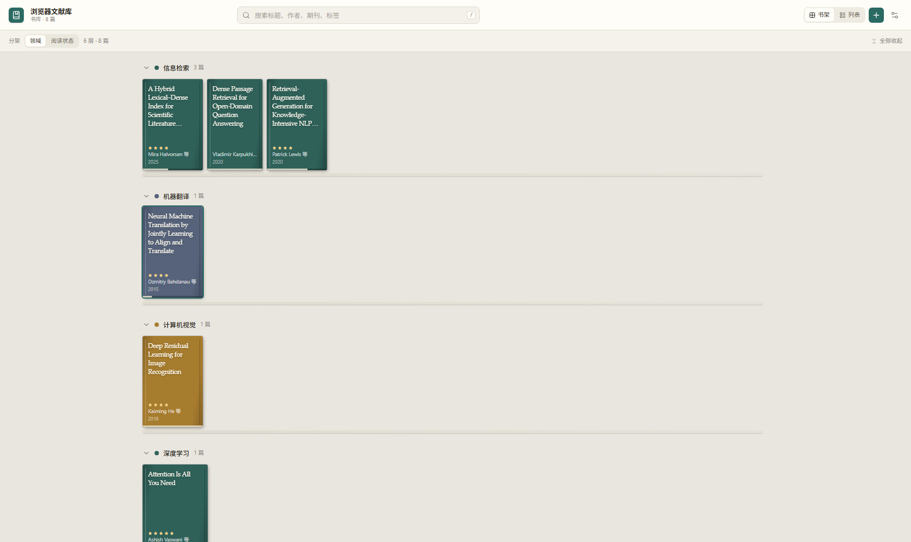

上面是启动首页的「书库」；下面这张是三栏阅读工作区，两者随时互相切换。

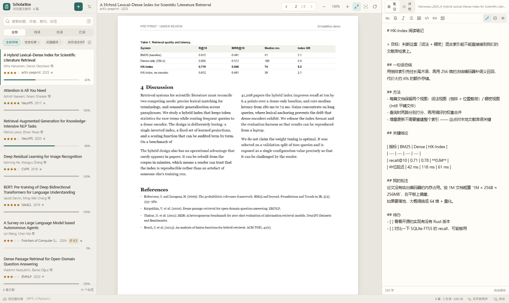

打开一个文献库，你看到的是：

```
MyVault/
├── vault.json                     # 库的元信息（名称、创建时间、上次同步）
└── papers/
    ├── Halvorsen_2025_A Hybrid Lexical-Dense Index/
    │   ├── origin.pdf             # 原始 PDF，不改名、不重编码
    │   ├── note.md                # 你的批注笔记（纯 Markdown）
    │   ├── meta.json              # 期刊 / IF / 作者 / 领域 / 星级 / 进度
    │   └── assets/                # 截图、摘录图片
    └── ...
```

换个软件打开、用 Git 同步、丢进坚果云、直接 `grep`，都可以。没有隐藏数据库，没有导出功能 —— 因为不需要导出。


## 技术栈

| 层 | 选型 | 说明 |
| --- | --- | --- |
| 外壳 | Tauri 2 | Windows / Linux / macOS + Android，体积小、内存低 |
| UI | React 19 + TypeScript 5.9 | 严格模式，无 `any` 逃逸 |
| 样式 | Tailwind CSS 4 | `@theme` 定义语义色板，明暗两套 |
| PDF | PDF.js 6 | 虚拟滚动 + 文本层，单页按需渲染 |
| 状态 | Zustand 5 | 拆分 settings / vault / library / reader / ui 五个 store |
| 同步 | isomorphic-git | 在 WebView 里直接 commit / push，不依赖系统 git |
| 笔记 | marked + DOMPurify | Markdown 渲染走白名单消毒 |

## 开发

```bash
npm install          # 依赖安装（见下方"已知限制"）
npm run dev          # 浏览器模式：OPFS 虚拟文献库 + 8 篇示例文献
npm run tauri:dev    # 桌面模式：需要 Rust 工具链
npm test             # 单元测试（vitest）
npm run build        # 类型检查 + 生产构建
```

浏览器模式（`npm run dev` 后打开 <http://localhost:1420>）会把文献库放在浏览器的
Origin Private File System 里，并在首次启动时写入 8 篇示例文献（含一份真实的双栏
PDF），所以**不装 Rust 也能把整个界面跑起来**。桌面模式下 `TauriVaultFS` 接管，
路径变成真实磁盘目录。

### 桌面 / 平板构建

| 平板（820 × 1180） | 深色主题 |
| --- | --- |
| 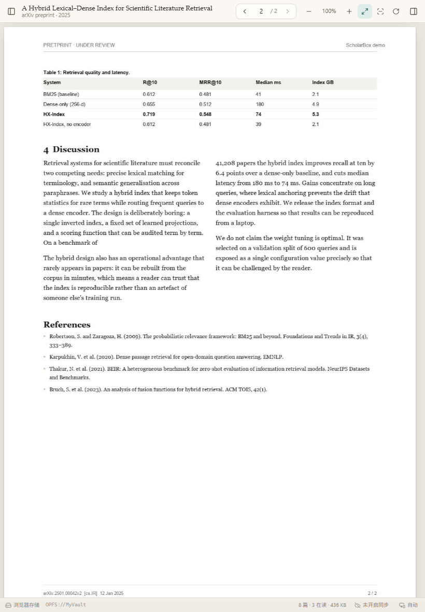 | 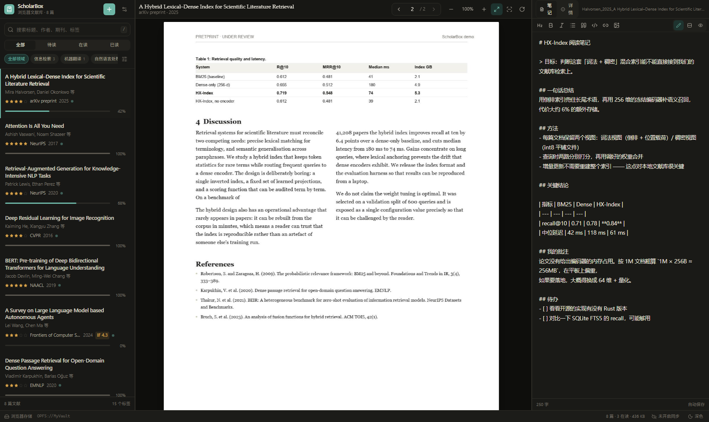 |

```bash
npm run tauri:build          # 产出 msi / dmg / AppImage
npm run android:init         # 生成 src-tauri/gen/android（需要 Android SDK + NDK）
npm run android:dev
```

Android 打包前记得重新生成启动图标：`python scripts/make_icons.py`。

## 目录结构

```
src/
├── components/
│   ├── layout/        AppShell / PanelResizer / StatusBar / BootScreen
│   ├── shelf/         书库首页：LibraryHome / ShelfRow / SpineCard / PaperPreview / 右键菜单
│   ├── library/       侧边栏：文献/笔记页签、搜索、状态页签、领域分面、筛选、文献条目
│   ├── vaults/        仓库切换器 / 仓库管理弹窗
│   ├── reader/        ReaderPane / PdfViewer（虚拟滚动 + 文本层）
│   ├── notes/         NoteSurface（共用编辑器）/ NoteEditor / FullNoteView / LiveEditor / AnnotationsTab
│   ├── settings/      通用 / 外观 / 同步（SyncSection）/ 翻译 / 关于
│   └── ui/            Button / Modal / Stars / ProgressBar / Field / IconButton
├── hooks/             useTheme / useVaultBoot（启动副作用，书库与工作区共用）
├── lib/
│   ├── fs/            VaultFS 抽象：tauri / browser(OPFS) / memory 三种实现
│   ├── vault/         repository（文件即数据库）、schema、模板、示例数据
│   ├── pdf.ts         PDF.js 装载、页尺寸测量、文本层
│   ├── pdf-capture.ts 区域截图（高清重渲染再裁剪）
│   ├── git/           isomorphic-git：fs 适配、仓库操作、Buffer polyfill
│   ├── shelf.ts       分架分组、伪封面配色、书脊尺寸（纯函数，单测覆盖）
│   ├── notes/         独立笔记：frontmatter 解析 + NotesRepository（CRUD）
│   ├── markdown.ts    渲染（marked + DOMPurify）
│   ├── markdown-edit.ts DOM → Markdown 回写
│   └── translate.ts   四个翻译 provider
├── stores/            zustand：settings / vault / vaults / library / reader / notes / standalone / sync / ui
└── styles/index.css   @theme 色板 + 组件类 + PDF 文本层样式
src-tauri/             Rust 侧：窗口、插件、文献库路径授权
scripts/               资源生成（示例 PDF、图标）、视觉回归截图
```

## 设计取舍

**为什么是「文件夹即数据库」。** 元数据写进每个文献自己的 `meta.json`，笔记写进
`note.md`。好处是任何一步操作都留下可 diff 的产物：同步、版本控制、迁移、修复
都退化成文件操作。代价是需要一个容错的读取层 —— `schema.ts` 对缺失字段、越界
数值、字符串形式的作者名、损坏的 JSON 全部做兜底，坏掉的 `meta.json` 不会让整个
文献库打不开。

**为什么不用 `react-resizable-panels`。** 三栏布局的拖拽逻辑不到 100 行，自己写可以
精确控制键盘操作、双击复位和移动端抽屉行为，也少一个依赖。

**为什么进度写入要 debounce。** 翻 500 页会触发 500 次 `setPage`，如果每次都写
`meta.json`，磁盘和 Git 都会被拖垮。阅读进度在内存里实时更新，落盘延迟 2.5 秒合并。

**为什么 Git 提交粒度是整个文献库。** 一次阅读会话通常同时改动 `note.md`、
`meta.json`（进度、标注）和 `assets/` 里的截图，拆成多个提交只会让历史更难读。
自动提交只 commit 不 push：本地快照可以随便打，推到远端应该由人决定。

**为什么 `.git` 放在文献库里而不是 AppData。** 这样「同步」就真的只是文件夹同步：
换机器只需要同一个 token + 同一个仓库地址，克隆下来就是一个能直接打开的文献库；
用户也可以随时用命令行或 GitHub Desktop 接管。

**为什么 PDF 走 asset protocol。** 500 MB 的 PDF 不能读成 `Uint8Array` 再穿过 IPC。
桌面端用 `convertFileSrc()` 让 WebView 直接按需读取字节区间；浏览器端退化为
`readBytes()`。

## 书库首页

启动后看到的是书库，不是阅读器 —— 大多数时候你是在「找下一篇读什么」，而不是接着上次
那一页。书架把 `meta.json` 里的领域画成层，一篇文献一枚书脊。

- **伪封面**：没有真实封面图，用分组主题色 + 标题 + 第一作者 + 年份拼出来。8 组配色
  用稳定哈希从 `meta.json` 的领域（或状态）算出来，同一个领域永远是同一个颜色；
  相邻两层若撞色会自动顺延一位。
- **书脊厚度 = 重要性**：1 星 84 px → 5 星 120 px，一眼能看出哪几篇是重点；
  底部 3 px 细条是阅读进度，读完的书基本看不出色条。
- **空分组不出现**，层可折叠（`全部收起` 一次收完），长书架横向滚动。
- 分架维度可以换成「阅读状态」，四层固定顺序：在读 / 待读 / 已读 / 归档。
- **悬停**浮层显示期刊 / 影响因子 / 星级 / 状态 / 进度 / 标签。
- **右键**：独立打开笔记（弹窗直接写 `note.md`）、标记状态（在读 / 待读 / 已读 / 归档）、
  编辑元信息、删除这条文献。
- 单击书脊进入三栏阅读器，PDF 会停在上次读到的那一页。

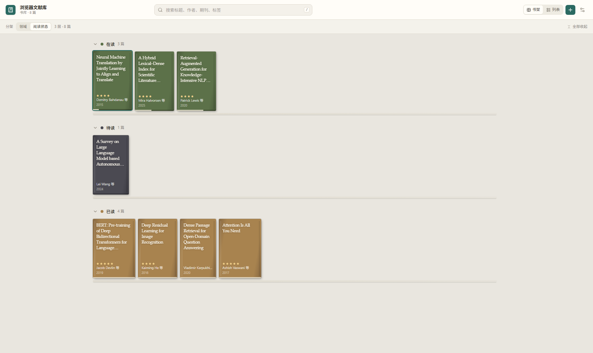

列表视图不是新写的 —— 它复用了三栏界面里的 `<LibraryPanel>`（搜索、状态页签、领域、
重要性、多选标签、排序全在），右半边补一个预览面板显示期刊、IF、标签、笔记摘要：

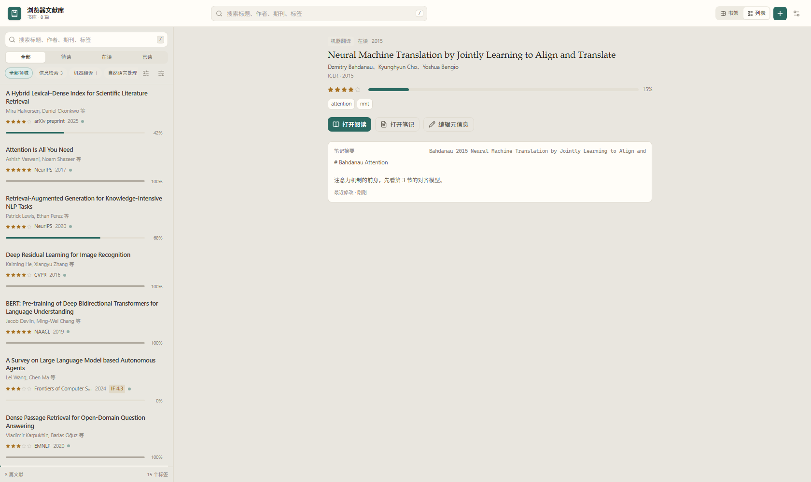

> 为什么不做真封面？抓取封面需要联网 + 解析出版商页面，失败率不低，而且会让「本地优先」
> 变成「联网优先」。`origin.pdf` 第一页渲染成缩略图是可行的下一步，但现在这版更轻。

## 多仓库

对标 Obsidian：**一个仓库 = 一个独立文件夹 + 一份独立的 Git 配置**。文献、笔记、标注、
`.git` 全都住在这个文件夹里，换仓库就是换文件夹。

<p align="center">
  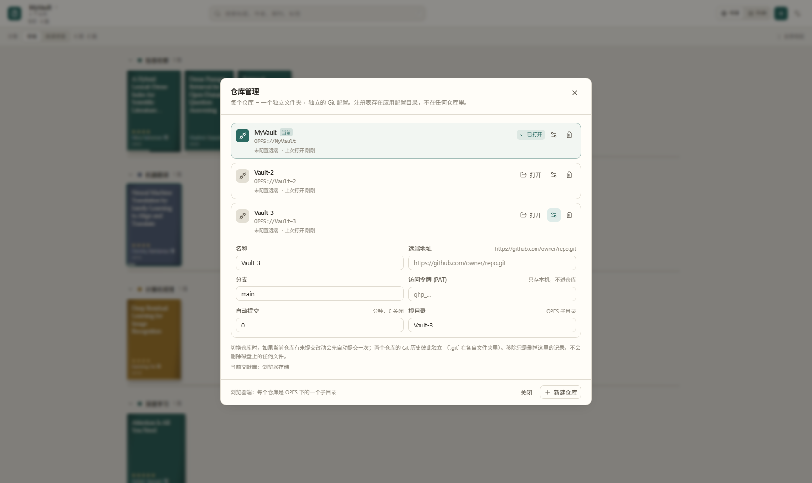
</p>

左上角是仓库切换器，点开可以切到别的仓库，或者进「仓库管理」：

<p align="center">
  
</p>

- **注册表不在仓库里**。桌面端写 `<appConfigDir>/vaults.json`，浏览器端写 `localStorage`；
  每条记录含 `id / name / rootType / rootPath / remoteUrl / branch / pat / autoCommitMinutes / lastOpenedAt`。
  这是硬约束：PAT 是明文，一旦落进仓库目录，下一次 `git push` 就把它推到 GitHub 上了。
- **切换是有顺序的**：当前仓库有未提交改动 → 先自动 commit 一次 → 拆掉旧的 `VaultFS` /
  git 层 / 文献 / 阅读器状态 → 打开新仓库 → 重新扫描 `papers/` → 刷新 Git 状态与历史。
  不做「先切再提交」，因为切换之后 FS 已经指向别的文件夹了。
- **两个仓库互不串扰**：`.git` 各自在各自文件夹里，远端地址与 PAT 也各存各的；单元测试
  用两个内存文件系统兜住这条（A 提交后 B 的历史仍为空，两边 `changeSummary` 互不影响）。
- **移除只是删记录**：`从列表移除` 只删注册表里的一行，磁盘上的文件一个不动。
- 桌面端 `新建仓库` / `打开已有文件夹` 走 `@tauri-apps/plugin-dialog` 选目录；浏览器端用
  OPFS 子目录模拟（`OPFS://Vault-2`），这样不用 Rust 工具链也能把多仓库流程跑通。

### 自定义仓库路径

`rootPath` 在注册表里统一是一个字符串，三种后端语义不同：

| 环境 | `rootPath` 写什么 | 说明 |
| --- | --- | --- |
| 桌面端 | `D:\papers\MyVault`（绝对路径） | 原样使用 |
| 桌面端 | `papers/2026/vault`（相对路径） | 相对 `appConfigDir/vaults/` 解析 |
| 浏览器 | `MyVault` / `研究/2026`（OPFS 相对目录） | 子目录可以有多层 |
| Android | `content://…`（SAF URI） | 预留，当前原样保存 |

新建仓库和仓库设置里都能直接填路径，桌面上仍有「选择文件夹」按钮：

<p align="center">
  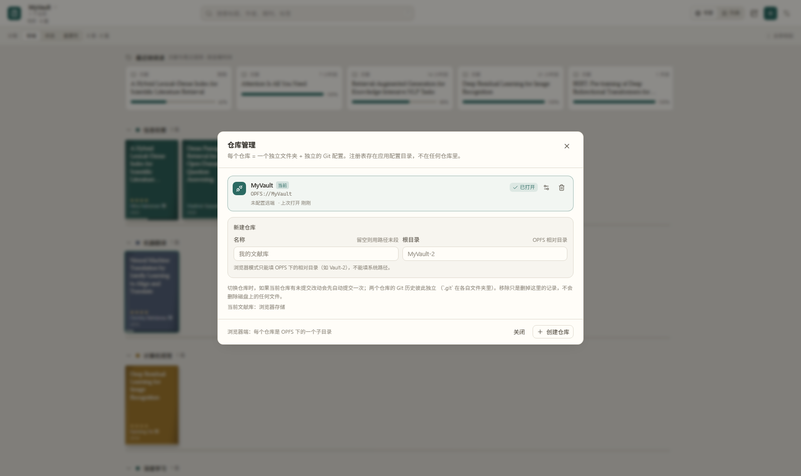
  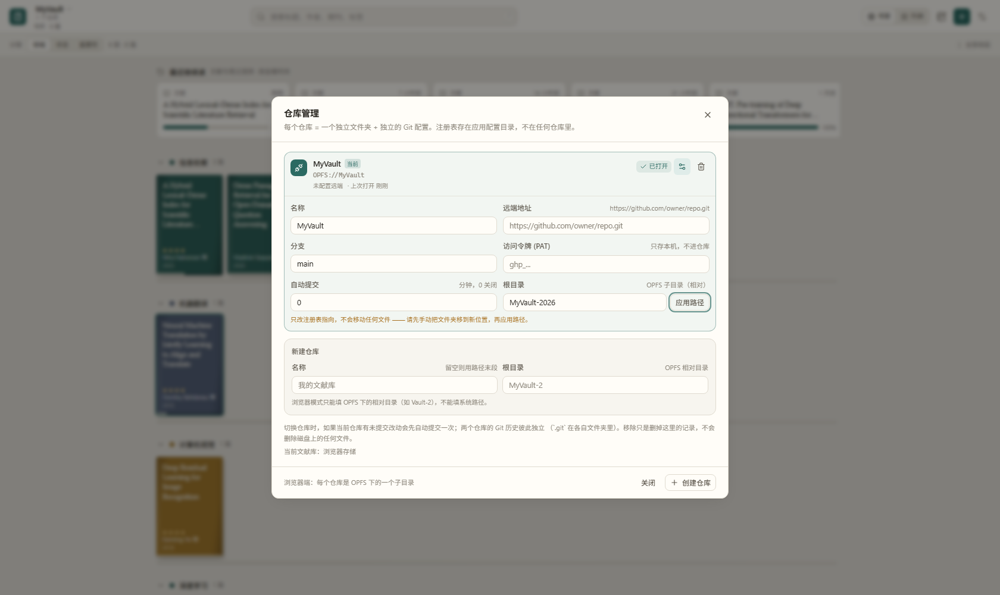
</p>

保存前会做四类校验，失败时给出具体原因而不是一句「保存失败」：

1. **写法**：空路径、`..` 越界、浏览器端填系统绝对路径都会被拒绝（浏览器不会假装能访问 `D:\`）；
2. **重复**：同一个规范化路径只能注册一次（修改自己的路径时不会跟自己撞）；
3. **可读写**：真的建目录 → 写一个探针文件 `.scholarbox-path-probe` → 读回来 → 删掉，
   失败会区分「无法创建」「不可写」「不可读」；
4. **可切换**：改的是当前仓库时，先自动 commit 未提交改动，再拆 `VaultFS` 重开。

**改路径只改注册表指向，不搬文件**。所以 UI 上明确写了「请先手动把文件夹移到新位置」——
自动搬 500 MB 的 PDF 目录属于另一个危险等级的操作，不该藏在一次输入框失焦里。

### 目录结构（一个仓库内部）

```
<仓库>/
├── .git/                 ← 这个仓库自己的历史
├── vault.json            ← 仓库自身的显示名与创建时间（可以进 Git）
└── papers/
    └── Vaswani_2017_Attention_Is_All_You_Need/
        ├── origin.pdf
        ├── note.md
        ├── meta.json     ← 元信息 + 标注
        └── assets/       ← 截图
```

> 首次启动会做一次迁移：把旧版「单仓库 + 全局 GitHub 配置」折算成注册表里的第一条记录，
> `lastOpenedAt` 就位，行为跟以前一模一样，只是路径不再硬编码。

## PDF 标注与划词翻译

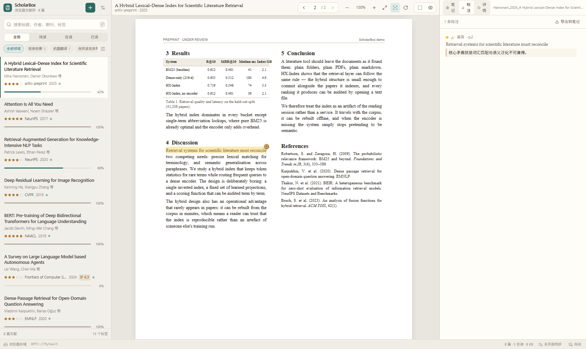

在 PDF 里选中文字就会浮出工具条：五色圆点（黄 / 绿 / 蓝 / 粉 / 紫）直接上高亮，
右侧是下划线、删除线、批注、翻译、复制。快捷键在选中状态下直接生效：
`H` 高亮、`U` 下划线、`S` 删除线、`N` 批注、`T` 翻译、`Esc` 关闭。

**数据落在哪。** 每条标注是 `meta.json` 里 `annotations` 数组的一个元素：

```json
{
  "id": "a-m3k9x1-7f2",
  "kind": "highlight",
  "page": 2,
  "color": "yellow",
  "rects": [{ "x": 0.117, "y": 0.395, "w": 0.372, "h": 0.019 }],
  "text": "Retrieval systems for scientific literature must reconcile...",
  "note": "核心矛盾就是词汇匹配与语义泛化不可兼得。",
  "createdAt": "2026-11-15T15:58:31.204Z",
  "style": { "opacity": 0.5 }
}
```

`kind` 只有五种：`highlight` / `underline` / `strikethrough` / `note` / `rect`（框选）。
旧文件里的 `strike` 在读盘时自动升级为 `strikethrough`，`underline` 不会被误改。

同一篇文献的**默认样式**存在 `meta.json` 的 `styles` 里（`annotationStyleVersion: 2`）：

```json
{
  "annotationStyleVersion": 2,
  "styles": {
    "highlight":     { "color": "#f2c94c", "opacity": 0.38, "paddingY": 0.04 },
    "underline":     { "color": "#f2c94c", "opacity": 1, "width": 2,   "offset": 0.9 },
    "strikethrough": { "color": "#f2c94c", "opacity": 1, "width": 1.6, "offset": 0.5 }
  }
}
```

工具栏的调色板按钮改的是**这篇文献的默认值**；单条标注的编辑器里再改一次就是
**单条覆盖**（只把改过的键写进 `style`），两者互不干扰。

`rects` 用的是 0–1 的**页面相对坐标**，与画布像素无关 —— 换缩放比例、换屏幕、
换设备都不会让高亮错位。同一个高亮跨行时会有多个 rect，生成时就已按行合并。

**为什么高亮不会「中间行更重」。** 浏览器给跨行选择返回的矩形里，同一行会同时
给出「字形盒」和「行盒」两个盒子（高度差 6–8px、纵向重叠 9–13px）。以前两个都画、
还叠加 `mix-blend-mode: multiply`，中间行上下各被压一遍，于是最重。现在
`consolidateRects()` 按行聚合、只保留一个 rect，渲染用纯 `rgba` 背景并加
`isolation: isolate`，同一区域只上一次色。**删除线也不再是「盒子的上边框」**，
而是一条独立的中线元素（默认 50% 高度），因此不会再看起来像下划线。
细节与实测数据见 [ANNOTATION_REVIEW.md](ANNOTATION_REVIEW.md)。

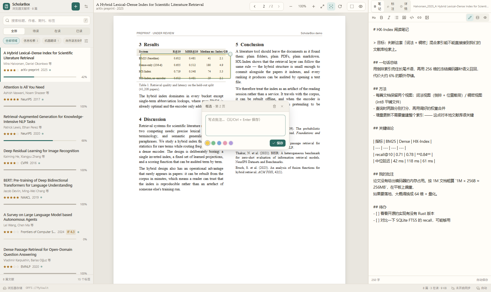

工具栏的方框按钮进入「框选标注」：在页面上直接拖出一个矩形，适合框住图表、
公式或表格写批注。矩形同样是相对坐标，能跟着缩放走。

右侧「标注」页签按页码排序列出全部标注，点一下跳到对应页并打开编辑框；
「导出到笔记」把标注渲染成 Markdown 追加到 `note.md`：

```markdown
## PDF 标注 · A Hybrid Lexical–Dense Index for Scientific Literature Retrieval

> 由 ScholarBox 于 2026/11/15 23:58:38 导出，共 1 条。

### 第 2 页

> Retrieval systems for scientific literature must reconcile

*高亮 · p.2*

核心矛盾就是词汇匹配与语义泛化不可兼得。
```

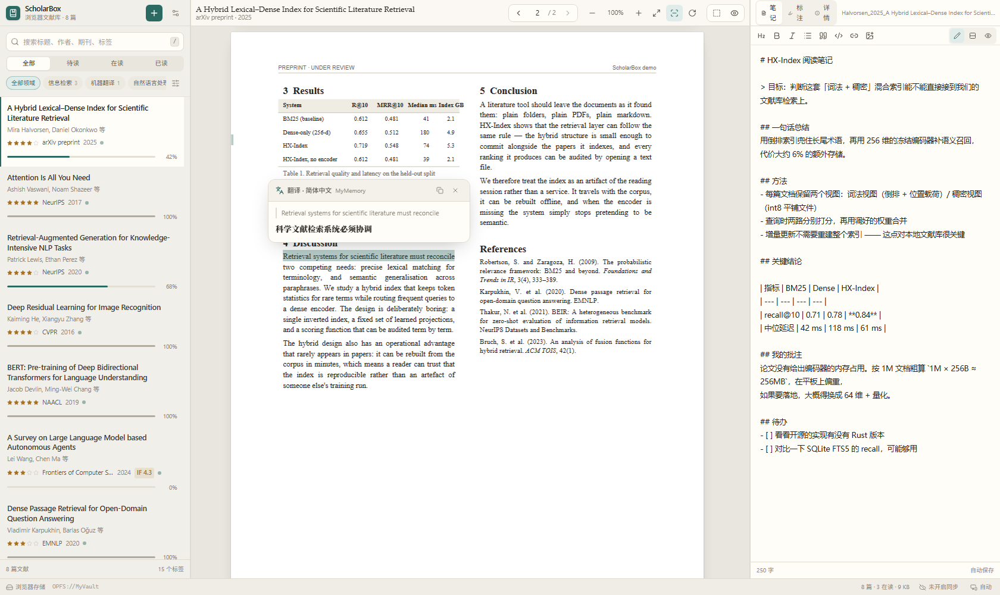

**划词翻译**只把选中的那一小段发出去，不发整篇 PDF。默认用 MyMemory
（免 Key、允许跨域、国内可直连）；设置里还能切 Google 免费接口、DeepL、
OpenAI 兼容接口。译文卡片可以一键复制进笔记。

**为什么高亮画在文本层下面。** 高亮如果用覆盖层接收鼠标事件，划词、复制、翻译就全
被挡住了。所以 `.pdf-mark` 层在文本层之下（`z-index: 1 < 2`）且
`pointer-events: none`，只有行尾那颗小圆点可以点开批注 —— 高亮过的文字依然能选。

**为什么标注写入也要 debounce。** 拖框、改批注时每一帧都可能触发一次状态更新，
500 ms 合并落盘；关页或被切到后台时 `beforeunload` / `visibilitychange` 兜底 flush。

**为什么默认用 MyMemory。** Google 的免费接口在国内网络基本不可达（本机实测
8 秒超时），而 MyMemory 不需要 Key、原生开放跨域。代价是单请求 500 字符上限，
所以长段落按词边界切片后串行请求。

## 笔记编辑器：阅读 / 源码 / 实时预览

笔记底层是 CodeMirror 6，三种模式，和 Obsidian 的三态一一对应：

| 模式 | 行为 |
| --- | --- |
| **阅读** | 只读。marked + DOMPurify 渲染成 HTML，表格、图片、`[[双链]]` 都按排版结果呈现，不能编辑 |
| **源码** | 原样显示所有 Markdown 标记，语法高亮照样有 |
| **实时预览** | 光标所在行露源码，其余行藏掉标记、按渲染样式显示 |

实时预览的规则（`src/lib/editor/markdown-syntax.ts` 扫描，`MarkdownEditor` 上装饰）：

- 标题的 `## `、引用的 `> `、粗体 `**`、斜体 `*`、删除线 `~~`、行内代码的反引号、
  链接的 `[...](...)` —— 标记全部藏起来，只留正文并套样式；
- **列表还原成看得见的符号**：`- ` 换成圆点、`1. ` / `2)` 换成对应序号，
  嵌套层级用「悬挂缩进」呈现（padding + text-indent，见下）；
- 任务列表 `- [ ]` 换成勾选框；
- **多级列表**：嵌套的 `-` / `1.` 各级圆点跟着缩进，换行后的文字与首行对齐
  （以前缩进空格只缩进首行，折行后文字顶回行首）；
- **公式**：`$E=mc^2$` 行内、`$$…$$` 块级（可跨行），KaTeX 渲染，
  语法与 Obsidian 一致 —— `$` 后不能紧跟空格，行内代码与代码围栏里的 `$` 不算；
  公式打错不抛错，原样显示原文。阅读模式同样支持；
- **代码围栏**：整块渲染成带底色的代码块（光标进块内露源码）；
- **单行 HTML**：`<p>…</p>`、`<details>…</details>` 这类一行写完的块级标签
  直接渲染成真元素（DOMPurify 消毒，阅读模式一贯如此）；
- 光标移到哪一行，哪一行立刻恢复源码，改标记不用切模式。

几个实现细节，翻代码时容易踩：

- **字号不再跳变**：主题（字号、字体、换行）住在 `options` compartment，
  可编辑性单独一个 `readonly` compartment。以前切模式把整个 `options` 重配成
  editable/readOnly，主题被清掉，字号从设置值掉回浏览器默认；
- **块级 widget 必须走 StateField**：代码围栏和 `$$…$$` 的替换区间跨行，
  CodeMirror 不允许跨行 replace 装饰从 ViewPlugin 出 —— 放 plugin 里整片装饰
  会静默失效。行内装饰（圆点、勾选框、行内公式、图片、单行 HTML）仍在 plugin；
- **块级 widget 的字号跟正文一致**：BlockWidget 挂 `md-body` 类复用样式，
  但 `md-body` 钉死 14.5px（阅读模式默认值），`pre`/`code` 又各带 0.82em/0.86em
  缩放 —— 嵌套起来双重缩小，代码块会比正文小近一号。在 `.cm-host` 作用域内
  统一归一成 `1em`，跟随编辑器字号设置；
- **标题折叠不被公式卡住**：公式块里单独一行的 `=`（LaTeX 赋值式）会被 Markdown
  解析成 setext 标题，把标题的 section 从公式中间截断，折叠范围到公式就停了 ——
  表现为「收起标题时公式收不起来」。现在标题折叠走自定义的 `foldService`
  （按行找下一个同级/更高级标题），不依赖语法树；同时折叠范围内的块级
  widget（公式 / 代码块）会让位给折叠占位符，折叠后真正从屏幕上消失。

### 文献笔记唯一文件名（noteName）

老库的文献笔记全部叫 `note.md`——双链要求唯一文件名，这是隐患。现在：

- 新建文献时笔记文件 = `papers/<目录>/<标题>.md`，meta.json 记录 `noteName`；
- **老库自动迁移**：读库时把 `note.md` 改名为 `<标题>.md`（幂等，只跑一次），
  老的路径写法链接（`[[papers/x/note.md]]`）一并改写；
- 编辑器里改文献标题 → 笔记文件跟着改名，全库 `[[旧标题]]` 与路径引用自动更新；
- `[[ ]]` 补全列表里的文献笔记从此各不相同（显示真实文件名）。

### 关系图谱（Obsidian 图谱 + 关系线文字）

笔记书架顶栏的「关系图谱」按钮打开交互式图谱：

- 节点 = 文献笔记（青）/ 独立笔记（紫）/ 未解析的引用目标（虚线空心）；
- 边 = `[[链接]]` / `![[嵌入]]` / 块引用，重复提及自动去重；
- **关系线文字（超出 Obsidian 的增强）**：点击一条连线，可以给这层关系命名
  （例如「引用了它的方法」「后续工作」），标注保存在 `.scholarbox/graph.json`，
  显示在连线中点，可编辑可删除；
- 力导向布局自动排布，拖动节点整理，悬停高亮邻接，点击节点打开笔记。

### 块引用 ^block-id

- 行尾追加 ` ^block-id` 给段落 / 列表项 / 标题一个可引用的身份；
- `[[笔记#^block-id]]` 跳转：打开笔记并滚动定位到那一块（光标落位）；
- `![[笔记#^block-id]]` 嵌入：只内联那一块的正文（阅读模式与实时预览）；
- 输入 `[[笔记#^` 自动列出该笔记的全部块 id（带行内容摘要）；
- 反链计入块引用；`[[ 笔记 > ^id ]]` 形式的标签在实时预览与阅读模式正常显示。

### 内容嵌入（transclusion）

`![[笔记]]` 把另一篇笔记的正文内联进当前笔记——Obsidian 的嵌入语法：

- 阅读模式与实时预览都内联渲染（走完整阅读管线：wiki / 公式 / callout / 高亮）；
- 目标解析与链接跳转同一套规则：`notes/x.md`、`papers/<dir>/<名>.md`、纯名字；
- 防环（A 嵌 B、B 嵌 A）+ 深度 3 层上限，找不到目标显示占位提示；
- 嵌入里的图片地址自动解析，wiki 链接可点击跳转；`![[图片.png]]` 与 `![[pdf]]`
  行为不变（图片内联、PDF 卡片链接）；
- 嵌入也算一条反向链接。

### 笔记系统对齐 Obsidian（第三批）

- **`==高亮==`**：实时预览与阅读模式都渲染成黄色 mark（代码与 frontmatter 不误判）；
- **Callout 提示块**：`> [!warning] 标题` 支持 Obsidian 全部类型
  （note / tip / warning / danger / example…按色系归一），阅读模式渲染成色块 +
  标题行，实时预览整行着色并藏掉 `[!type]` 标记；
- **大纲面板**：全屏笔记标题栏的「大纲」按钮打开右侧抽屉，按层级缩进列出标题，
  点击直接跳到对应行（编辑器 revealLine）；
- **反向链接面板**：「反链」按钮列出全库谁用 `[[ ]]` 链到了当前笔记（含摘录与行号），
  点击跳到来源笔记。匹配规则与链接跳转一致（路径 / 纯名字 / 文献夹名）；
- **未解析链接点击创建**：`[[不存在的笔记]]` 点击即创建同名独立笔记并打开（Obsidian 闭环）；
- **Ctrl+E**：编辑（实时预览）与阅读之间切换；
- **重命名联动引用**：重命名独立笔记时全库扫描，`[[旧名]]` / `[[notes/旧名]]`
  自动改写为新名字（纯名字写法改标题、路径写法改路径、别名保留），历史与反链不断链。

### 导入 Markdown 笔记

笔记页顶栏的「导入 Markdown」按钮（侧栏的「新建笔记」旁也有）可以一次选
多个 `.md` / `.markdown` 文件，导入成独立笔记：

- 显示名 / 文件名取源文件名，撞名自动 `-2`；
- 源文件里已有的 YAML frontmatter（`tags` / `field` / `status`）会解析进
  笔记元信息——导入的笔记自动归到对应领域书架；
- 正文原样保留，应用自己的 frontmatter 记创建时间等；
- 全局拖拽也认：把 `.md` 拖进窗口即导入（PDF 仍是建文献）。

### 独立笔记的显示名 = 文件名

独立笔记在界面上的名字一律用文件名（`notes/<名字>.md` 去掉后缀），
与 Obsidian「文件名即笔记名」一致。此前显示名取正文里的第一个 `# 标题`，
在编辑器里改了标题，显示名就跟着飘、和实际文件对不上。现在：
正文标题只是内容；想改名字走标题栏「点击重命名」，它会把文件和
`# 标题` 一起改掉，两边永远同步。

### `[[wiki 链接]]`（Obsidian 语法）

`[[笔记名]]`、`[[路径|别名]]`、`![[图片.png]]` 全支持：

- **实时预览**里双方括号被藏掉，显示成可点的链接（点一下就跳：笔记进全屏编辑，
  PDF 回阅读器）；图片嵌入直接渲染成真图；
- **阅读模式**同样可点（`scholarbox-wiki:` 协议）；
- 输入 `[[` 自动补全仓库里的笔记与 PDF；
- 只写名字不写路径（`[[JCMM-29-e70554]]`）也能跳 —— 按独立笔记标题、文献标题、
  文献夹名依次解析，大小写不敏感。这是 Obsidian 用户的习惯写法。

### 书架置顶

每一层书架的标题行右侧有置顶按钮（悬停出现）：置顶的层始终排在最上面，
再点一次取消。文献书架与笔记书架通用，切分架维度后置顶跟组名走。

### 全屏笔记的双栏对照

标题栏的「双栏」按钮（`Columns2`）再打开一篇笔记：左右各一篇，各自独立的
光标、编辑模式与草稿，改动即时保存。选择弹窗里文献笔记和独立笔记都能挑，
带搜索；右栏的关闭按钮只关右栏，左栏「返回」关整个视图。重命名一篇被
双栏打开的笔记，对应栏会自动跟上新文件名。

### 书架缩放

书架工具条右侧新增 `− / 100% / +` 缩放控件：书脊卡片整体放大缩小
（70%–160%，10% 一档），点百分比数字恢复默认。文献书架与笔记书架共用。

### PDF 页面缺失与图片丢失（已修）

pdf.js ≥5 把 JPEG2000 / JBIG2 解码和 ICC 色彩管理挪进了 WASM，但没给 `wasmUrl`
时这些解码器**静默不可用**：扫描版 PDF（每页一张 JPEG2000 图）整页空白，
看起来像「缺页」；普通 PDF 的插图直接消失。现在 `getDocument` 带上了
`wasmUrl: /pdfjs/wasm/` 与 `iccUrl: /pdfjs/iccs/`（资源随安装包发布）。

另外两道保险：

- 单页渲染失败不再静默吞掉 —— 页面上会显示「第 N 页渲染失败 + 重试」；
- 海报 / 大版面页在高缩放 + 高分屏下会超出 Chromium 画布上限（16384px / ~2²⁴ 像素），
  超限时自动压低 devicePixelRatio，宁可糊一点也不给白纸。

### 分割线

`---`（以及 `***`、`___`）现在渲染成分割线：实时预览整行换成真的 `<hr>`，
光标移进去露源码；阅读模式 `<hr>` 照常。frontmatter 的 `---` 不会被误认。

### Git 回退到某条提交

设置 → GitHub 同步 → 历史记录，每条提交右侧有「回退」。实现是
**生成一个新提交把所有文件恢复到当时的状态**（对比 HEAD 树与目标树，
删掉多出来的文件、覆盖改动过的），历史完整保留，直接 push 即可，不需要 force。
回退前会先把当前未提交的改动自动提交，保住手上的笔记。

### 笔记外观：底色 / 版心宽度 / 字号

三个旋钮都在**笔记工具栏的「Aa」浮层**里（设置 → 外观 → 编辑器 里也有一份）：

- **底色**：跟随主题、纯白纸、米黄、护眼绿、冷灰、深墨。不是简单铺一层
  `background-color` —— 它整体覆盖 `--sb-*` 变量，所以代码块、引用、表格、
  行内代码的底色会跟着一起变，不会出现「白底代码块压在米黄纸上」；
- **版心宽度**：窄 40rem / 中 48rem / 宽 62rem / 满宽。以前 `.cm-content` 被写死
  `max-width: 76ch`（约 620px）而容器有 992px，于是文字挤在左边、右边一大片空白 ——
  单独打开笔记时最明显。现在宽度由这个设置决定；
- **字号**：11–28px，**滑杆可以用鼠标拖**，拖动即时生效；A− / A+ / 重置 也在浮层里。
  阅读模式共用同一个字号。

顺带清掉了三个「拨了没反应」的开关（实时预览、嵌入预览、列宽标尺）：
它们的实现早已换掉，留着只会让人以为坏了。列宽标尺的职责现在由「版心宽度」承担。

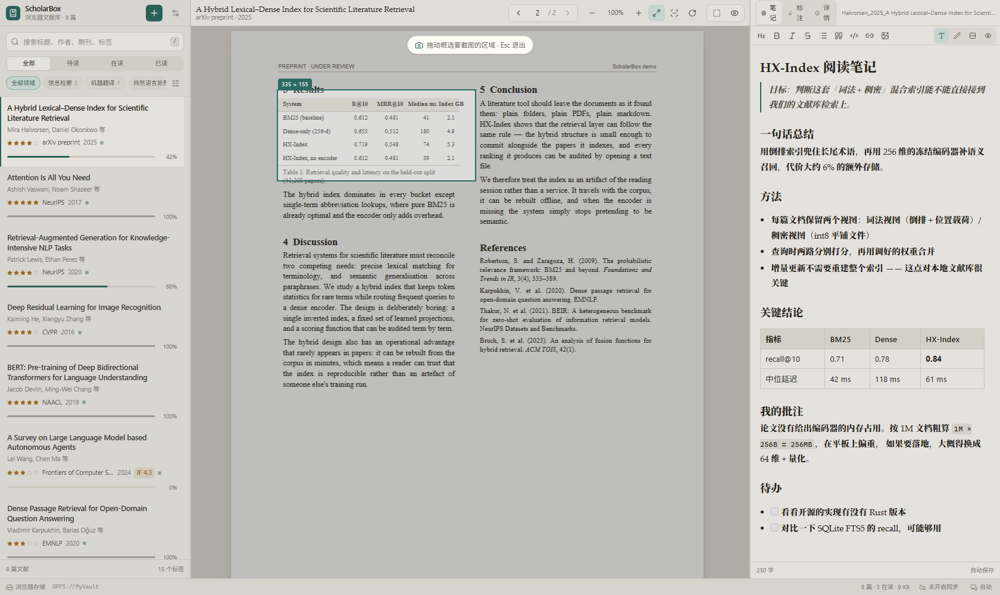

`Shift+X`，或点 PDF 标题栏 / 笔记栏里的相机图标，进入框选模式：拖一个框，松手即完成。
截图按 `p<页码>-<时间戳>.png` 存进当前文献的 `assets/`，`note.md` 里插入一行
``。

插入位置和换行有讲究（`src/lib/editor/block-insert.ts`，有单测）：

- 光标在**一句话中间**：前后各补一个空行，把图片单独成块，不会把段落劈成两半；
- 光标在**列表项下面**（`- [ ] `）：必须隔一个空行，否则图片会被算成列表项的内容；
- 光标在一篇**还没动过的笔记**里（selection 停在 0）：追加到文末，而不是跑到标题上面；
- 连续截两张：第二张接在第一张下面，中间留一个空行，不会越插越松散。

截完在**实时预览里直接看到图**（不再是一行 `` 源码），阅读模式同样显示。
以前阅读模式只认 `scholarbox-wiki:`，`assets/xxx.png` 这种相对路径会裂图 ——
现在三条渲染路径统一走 `resolveNoteImagePath()`。

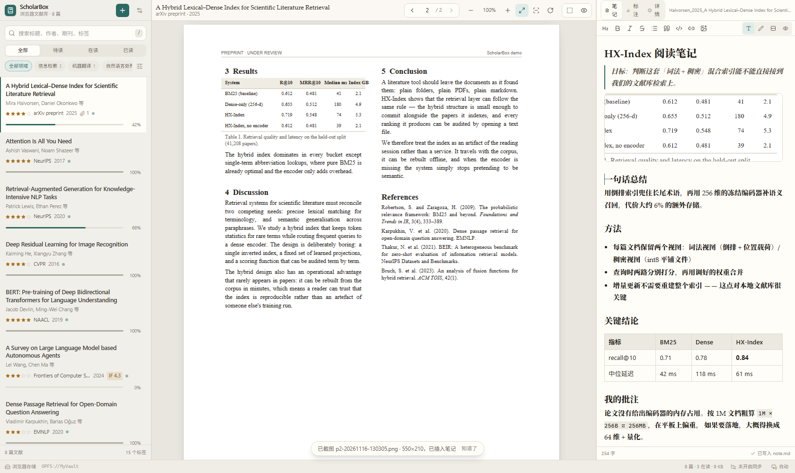

**为什么截图要重新渲染，而不是裁屏幕上的画布。** 屏幕上的 canvas 是「缩放 ×
dpr」的位图，直接裁下来再放大就是糊的，而且显示器换了、缩放变了，同一段内容
截出来的清晰度还不一样。所以框选之后是按 PDF 坐标把那一页以 2 倍目标宽度**重新
渲染一遍**再裁 —— 得到的图在任何设备上都一样清晰。

**为什么插入点选在「光标所在段落之后」。** 图片是块级内容，硬塞进句子中间会把
那段话劈成两半，塞进引用或列表里还会多出一堆空的 `>` 行。所以插入位置统一落在
当前段落的后面，正文一个字都不动。

**为什么 `note.md` 里写相对路径。** 写的是 `assets/xxx.png` 而不是
`papers/xxx/assets/xxx.png`。整个文献文件夹被搬走、改名、或者被 git 同步到另一
台机器上，链接都不会断。

## 笔记：独立的一等公民

笔记不再只是「文献的附属物」，而是和文献并列的东西。

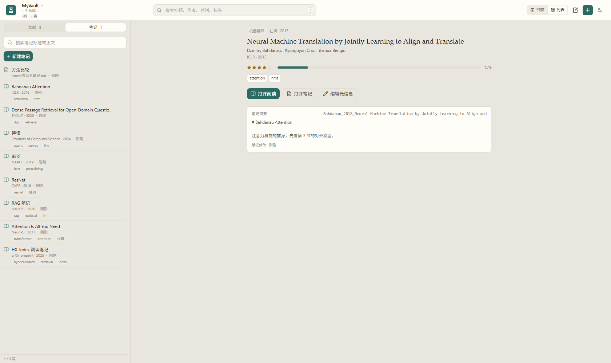

左侧栏的「笔记」页签把两类笔记**并成一张表**：每篇文献的 `note.md`，以及仓库根
目录下 `notes/` 里的独立笔记。合并的理由很实际 —— 想找「我上次写过的那段」时，
人不记得它当初是挂在某篇论文下面，还是单独开的。同一张表里，搜索、标签筛选、
按更新时间排序对所有笔记一视同仁。

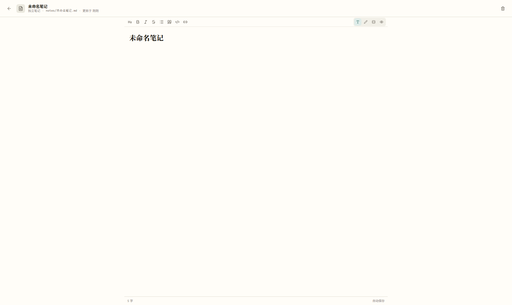

点任意一行（或者文献列表项上的笔形图标、右栏笔记页签的 ↗ 图标）进入**全屏笔记
视图**：没有 PDF、没有三栏，只有正文和一个工具栏。这个视图和右栏里内嵌的编辑器
是**同一个组件**（`NoteSurface`），数据源也是同一个（文献走 `note.md`，独立笔记
走 `notes/*.md`）—— 所以「内嵌」和「独立」不会长出两套行为，自动保存、截图插入、
模式切换、字数统计全都一致。

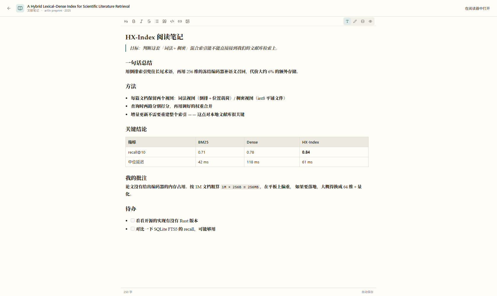

独立笔记落在 `<仓库>/notes/<标题>.md`，一篇一个文件：

```markdown
---
createdAt: 2026-11-16T19:30:00.000Z
updatedAt: 2026-11-16T19:42:11.000Z
field: 信息检索
tags: [方法, 待整理]
importance: 4
status: active
pinned: true
---

# 方法比较

BM25 与稠密检索的取舍
```

frontmatter 只用标准 YAML，Obsidian 或任意编辑器都打得开；解析器不引第三方 YAML
库，认不出的键原样留住（`extra`），不会因为别人多写了一行就丢数据。旧笔记的
`created` / `updated` 会被读成新键，`status` 也接受旧的阅读状态（`reading` 当
`active`、`done` 当 `archived`）—— 迁移是**读的时候补默认值**，不批量改写磁盘文件。
全是默认值时干脆不写 frontmatter，纯正文的笔记保持干净。

**为什么保存时不直接覆盖 frontmatter。** 编辑器只把正文交回来，如果照着「新正文
+ 新时间」写回去，`createdAt`/`tags`/`field`/`importance` 全没了。所以 `save()`
先读一遍磁盘上的旧文件，继承这些元信息，只把 `updatedAt` 打成当前时间。

## 笔记库：和文献库同一套骨架

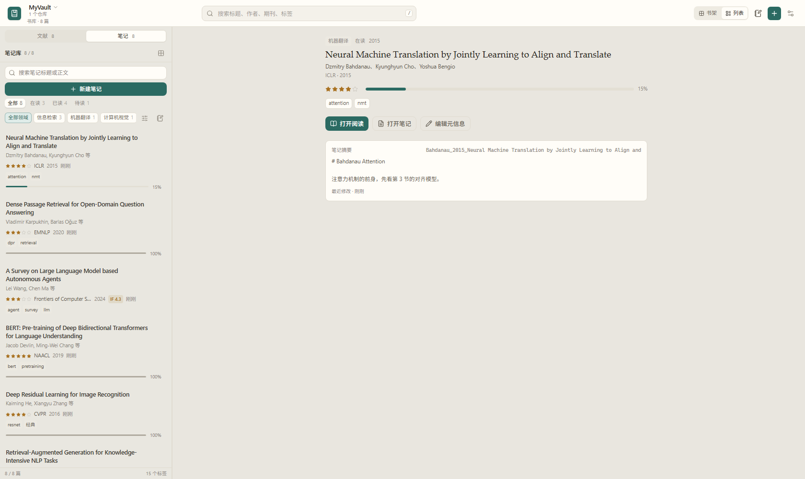

「笔记」页签不是一张特殊列表，它和文献库共用同一套东西：同一个条目模型
（`LibraryItem`）、同一个筛选器（`filterItems`）、同一个排序器（`sortItems`）、
同一个书架（`buildShelves` + `ShelfRow`）。差别只有「条目从哪来」——文献笔记从
`papers/<dir>/note.md`，独立笔记从 `notes/<file>.md`。

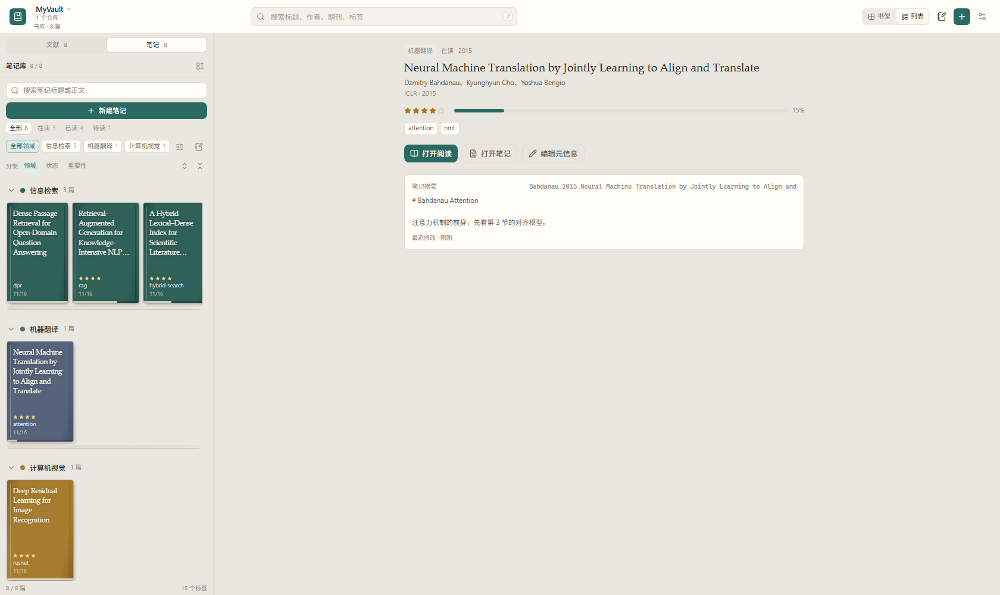

列表里能做文献库能做的一切：搜索正文、领域 chips、标签多选（交集）、重要性 ≥N
星、状态页签、六种排序；切到书架还能按 领域 / 状态 / 重要性 分架。悬停浮层和右键
菜单（独立打开 / 置顶 / 编辑元信息 / 删除）也一致。

**文献笔记的元数据不复制。** 这是这一版最重要的决定：文献笔记卡片上的期刊、IF、
作者、星级、领域、标签、状态、进度，全部**现读**同目录的 `meta.json`，`note.md`
里一个字段都不存。所以在笔记库里把某篇文献笔记标成 5 星、换个领域，回到文献库立
刻就是同一个值 —— 反过来也一样。两份数据必然漂移，所以干脆只有一份。单测
`文献笔记的元数据不复制` 锁住了这条：同一个 `PaperRecord` 分别转成「文献条目」和
「笔记条目」，逐字段相等；改 `meta.json` 后两种视图同时变。

**状态枚举跟着「条目从哪来」，不跟着「它出现在哪个库」。** 文献笔记列在笔记库里，
但它的状态是阅读状态（在读/待读/已读/归档），独立笔记才是 在写/草稿/归档。判据是
`statusKindOf(item)`（有没有 `paper` 字段），不是 `item.type` —— 后者会让文献笔记
的标签退化成 `reading`/`done` 这种英文原文。

**分类/重要性/置顶都是元数据。** 改领域、加星级、置顶，只是改 frontmatter 里的几
行，不会移动、重命名或复制任何文件 —— 文件路径永远只由标题决定，你在 Obsidian 里
看到的目录结构和 ScholarBox 里完全一致。

**为什么 `notes/` 放在仓库根，而不是 `papers/` 下面。** 独立笔记和文献无关，放进
`papers/` 会被目录扫描当成一篇文献。放仓库根还有个副作用是好的：它自动进入同一
个 `.git`，跟着文献一起被提交、推送、回滚，不需要额外接线。已在浏览器端确认
`notes/未命名笔记.md` 出现在待提交文件列表里。

## 笔记书架：笔记的主界面

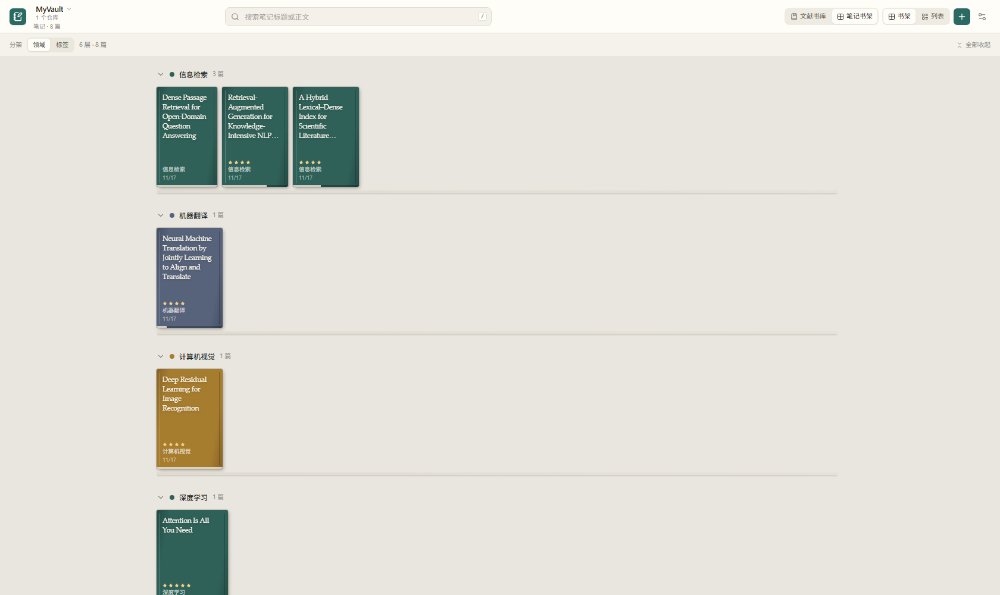

笔记不再是文献库里的一个页签。顶栏中间是「文献书库 / 笔记书架」全局切换，默认文
献书库，**选过一次就记住**（存在 `settings.homeSection`，跨启动保留）。

书架骨架和文献书库是同一套组件，不是照着抄的第二份：

| 组件 | 职责 | 谁在用 |
|---|---|---|
| `LibraryTopBar` | 仓库切换、全局搜索、`/` 聚焦、页码视图切换、页面级动作 | 文献书库、笔记书架 |
| `ShelfToolbar` | 分架维度、层数统计、清除筛选、全部展开/收起 | 同上 |
| `ShelfBoard` | 滚动容器、居中列宽、空状态 | 同上 |
| `ShelfRow` / `SpineCard` | 一层书架与伪封面 | 同上 + 侧栏笔记库 |
| `ItemHoverCard` | 悬停浮层（文献给期刊/IF/进度，笔记给分类/标签/更新时间/来源文献） | 同上 |

列表视图直接复用笔记页签那套列表与筛选（状态页签、领域 chips、标签多选、重要性、
最近查看、排序），没有为「主界面」再写一份。

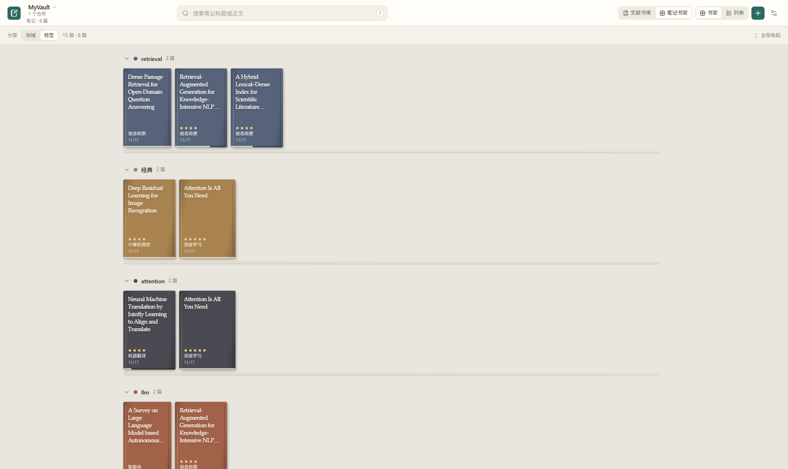

**分架维度是 分类（默认）/ 标签。** 标签这一维和领域有本质区别：领域是单值，一篇
笔记只进一层；标签是多值，**一篇多标签的笔记会同时出现在多个架里**。截图里 `15 层
· 8 篇` 就是这个原因 —— 架内计数之和大于笔记总数，这是标签的正确行为，不是重复
计数 bug。没有标签的笔记归到「无标签」架，不会被静默丢掉。

书脊卡片沿用伪封面：分架主题色底 + 标题 + **分类名**（笔记没有作者，副行给分类）+
重要性控制厚度 + 底部更新日期。空分类隐藏、分组可折叠、架内排序沿用笔记排序。

单击书脊进全屏笔记编辑；右键是 独立打开 / 置顶 / 编辑元信息 / 删除（文献笔记没有
删除项 —— 它属于文献，删文献要去文献库）。

## 最近继续读、最近查看与置顶

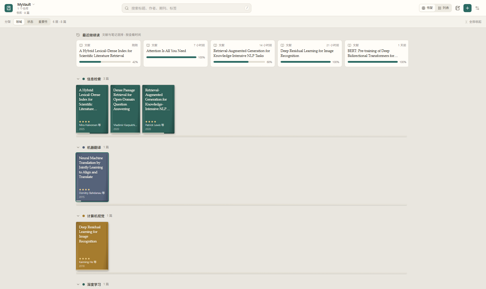

书库首页顶部多了一排「最近继续读」：文献和笔记混在一起，按查看时间倒序，点一下
回到对应的阅读器或全屏笔记。它不是新的数据类型 —— 就是把已有条目按
`lastViewedAt` 排一次（`recentlyViewed()`），所以笔记库、文献库里看到的排序和这里
永远一致。

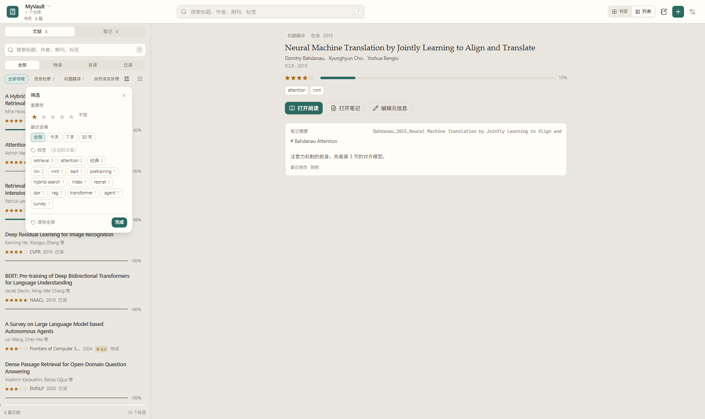

文献库和笔记库的筛选弹层都多了「最近查看」：全部 / 今天 / 7 天 / 30 天。**「今天」
按自然日算**，不是「最近 24 小时」—— 凌晨一点看过的论文，早上八点应该还在「今天」
里。这条有单测：昨天 23:50 的记录不算今天，今天 01:00 的算。

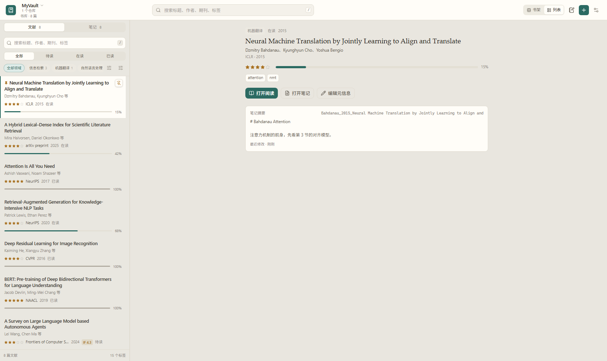

置顶是**分类内置顶**，不是全局置顶：置顶项只在它所属的那一层/那一组里排最前，
不会跨层往上跳。这一条由唯一的 `compareItems(a, b, sort, { pinnedFirst })` 决定 ——
书架每层、列表的分组模式都传 `pinnedFirst: true`，不分组的平铺列表传 `false`
（没有「所属组」时，置顶不该影响顺序）。四个入口都能置顶/取消：列表行（悬停出现
的图钉）、书脊卡片（左上角图钉，置顶时常亮）、
右键菜单、全屏笔记标题栏。

**两个字段的归属。**

| 条目 | `pinned` / `lastViewedAt` 存在哪 |
| --- | --- |
| 文献、文献笔记 | 同目录 `meta.json`（唯一真源，`note.md` 里不存） |
| 独立笔记 | `notes/<file>.md` 的 frontmatter |

所以置顶和最近查看天然按仓库隔离：它们就在仓库文件夹里，跟着 `.git` 一起同步；
切换仓库后读到的是另一个仓库里的值，不会串。单测用两个 `MemoryVaultFS` 各建一篇
文献，A 置顶后 B 仍是 `false`。

**列表视图的「按分类分组」。** 列表不再有「置顶」独立分组（那本来就是全局置顶时代
的产物）。取而代之的是工具栏上的分组开关：开着时按分类分成带小标题的段，每段内部
置顶最前；关掉时是一张平铺列表，`pinned` 完全不参与排序 —— 平铺列表里没有「所属
组」，再让置顶插队就回到了全局置顶的老毛病。文献库和笔记库各有一份开关状态。


**为什么 60 秒内只写一次。** 打开一篇文献会同时触发阅读器挂载、详情面板挂载、窗口
聚焦几个入口 —— 不去重的话翻十篇就是几十次 `meta.json` 写入，还都是无意义的
diff。所以 `markViewed()` 对同一项做了 60 秒节流（模块级 Map），切换仓库时清空，
避免「刚写过」的误判。老 `meta.json` 没有这两个字段时按 `pinned: false` 和
`lastViewedAt: lastOpenedAt` 兜底，`META_VERSION` 仍然是 1 —— 纯追加，旧文件不用迁移。

## 文献管理与筛选

左边栏是纯粹的文件视图：**一条记录就是一个文件夹**，标题、作者、期刊、IF、
领域、星级、标签、进度全部来自该文件夹下的 `meta.json`，改完立刻回写。

筛选维度可以叠加，互相之间是「与」：

- 搜索框：标题 / 作者 / 期刊 / 领域 / 标签 / 年份 / 文件夹名，空格分词取交集
- 状态页签：全部 / 待读 / 在读 / 已读（归档单独一个入口）
- 领域：横向 chips，带计数
- **重要性**：≥N 星
- **标签**：多选取交集（选了 `retrieval` + `survey` 就只剩同时有这两个标签的）
- 排序：最近阅读 / 最近添加 / 标题 / 重要性 / 进度

<p align="center">
  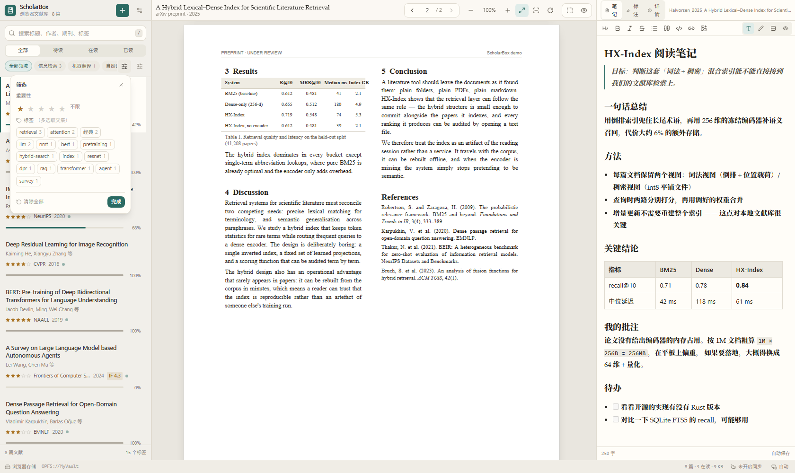
</p>

阅读进度有两条来源，都写进 `meta.json`：翻页时按「当前页 / 总页数」自动推进
（2.5 秒防抖，避免翻 500 页写 500 次文件），以及在详情面板里手动拖滑块 /
点「未开始 · 一半 · 读完」。拖动过程只更新界面，松手才落盘。

## Git 同步

isomorphic-git 直接跑在 WebView 里 —— **不需要系统装 git**。仓库根就是文献库根，
`.git` 就躺在 `MyVault/.git`，所以你在命令行里 `cd MyVault && git log` 看到的是同一份历史。

<p align="center">
  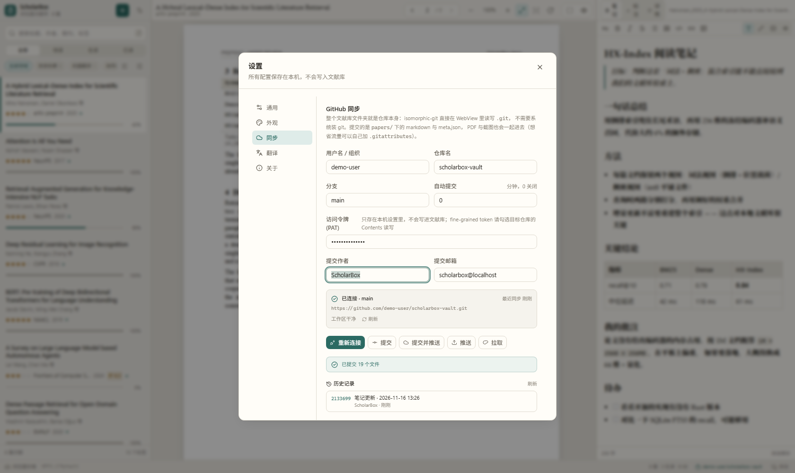
</p>

怎么实现的：

- `src/lib/git/fs.ts` 把 isomorphic-git 要的 promise-fs 接口（`readFile` / `writeFile` /
  `readdir` / `mkdir` / `rmdir` / `unlink` / `stat` / `lstat`，含 errno 风格错误）整体映射到
  `VaultFS` 上，于是桌面端、浏览器端、测试用的内存文件系统跑的是同一套 Git 代码。
- 提交粒度是「整个文献库」：`commitAll` 先把 `statusMatrix` 里的新增 / 修改 / 删除
  逐条 `add` / `remove`，再 commit；没有改动时返回 `null`，不产生空提交。
- 认证用 GitHub Personal Access Token（只存在本机设置里，不进文献库）。桌面端请求走
  Rust 侧 HTTP，没有跨域问题；浏览器模式只能经过 `cors.isomorphic-git.org` 公共代理。
- 拉取和推送都走同一个 `integrateRemote()`：先 `fetch` 拿远端 tip，本地已经包含它就是
  「已是最新」，有共同祖先就正常合并（本地落后时直接快进），**没有共同祖先就把远端历史
  接到本地历史后面**（见下一节）。任何情况下都不会替你丢弃一边的改动。
- 自动提交：设置里填分钟数，后台每 60 秒检查一次，有改动才提交，消息是
  `自动同步 · 2026-11-16 13:26`；推送仍然手动（避免把半成品状态推到远端）。
- 状态栏右侧常驻一个入口：显示 `owner/repo`、未提交文件数角标，点一下直达同步面板。

### 分支与本地 Git 维护

单人文献库也要分支：想试一套新的整理方式，搞砸了切回 `main` 就行。

| 操作 | 行为 |
| --- | --- |
| 新建并切换 | 从当前 HEAD 建分支并 checkout；名字会校验（不允许空格、`..`、`~^:?*[` 等） |
| 切换 | `checkout`。**切之前会先自动提交**当前改动（消息带「切换分支前自动提交」），否则未提交内容会跟着工作区跑到新分支上 |
| 合并进来 | 把选中分支合进当前分支；`allowUnrelatedHistories` 打开，两条各自起步的历史也能合，真冲突就整体中止（`abortOnConflict`），不留半个合并态 |

合并之后一定要 `checkout`：isomorphic-git 的 `merge` 只写 ref 和索引，不动工作区 ——
漏了这步，下一次提交会把刚合进来的改动「改回去」（老代码就是这么丢的）。

危险区（设置 → 同步 → 「本地 Git 维护」）：

- **重建并接上远端**：删 `.git` → 重新 init → 把远端历史接回来。文件一个不删，历史以远端为准。
- **只删除本地 Git**：删掉 `.git`，这个库不再是 Git 仓库（文件同样不动），之后可以重新「连接仓库」。

两者都要二次确认，因为**本地提交历史会消失**（`.git` 一走，`refs/scholarbox/backup/*` 也一起没了）。

### 出问题先看这三个日志

GUI 程序没有控制台，同步失败只看界面就会像这次一样「只看到不行」。日志在
`%LOCALAPPDATA%\ScholarBox\`：

| 文件 | 内容 |
| --- | --- |
| `startup.log` | 启动、WebView2 数据目录选择、建窗结果 |
| `git.log` | 每一次 git HTTP 请求：主机、状态码、字节数、耗时；走没走代理、是否回退直连 |
| `sync.log` | 前端每一步：`push.start` / `push.rejected` / `fetch.ok` / `integrate.adopted` / `error.push.report`… |

单个文件超过 512 KiB 自动滚成 `.log.1`，只留一代。

## 远端有本地没有的历史（推送被拒 / 拉取失败）

最常见的坏情况：**GitHub 上建仓库时勾了 README**（远端已经有一条提交），而本机的 `.git`
是 ScholarBox 新建的。两段历史**没有共同祖先**，于是：

- 推送被 Git 拒绝：`PushRejectedError: ... not a simple fast-forward`；
- 拉取也失败：isomorphic-git 默认不支持合并无关历史（`MergeNotSupportedError`）。

以前这两种情况只会甩一句「未知错误 / 拉取冲突」，用户几乎不可能自己判断。现在**自动修**：

1. 拉回远端 tip（`fetch`，只下载对象，不动工作区）；
2. 远端有、本地没有的文件先写到工作区 —— **远端内容不会被本地覆盖掉**；
3. 造一个**双父提交**：第一父是远端 tip（所以推送变成快进），第二父是本地 HEAD
   （所以本地那几条提交仍然在历史里看得见）；
4. 之前的本地 HEAD 额外备份到 `refs/scholarbox/backup/<时间戳>`，历史随时能找回
   （`git log refs/scholarbox/backup/xxx`）；
5. 再推一次。

两边都有的文件以**本地内容**为准（本地优先，用户看到的就是本地的）。实现见
`adoptRemoteHistory()` / `integrateRemote()`，单测在
`src/lib/git/__tests__/repo.test.ts` 的「无关历史」一组。

## 同步失败怎么读

同步出错时不再只说「网络不通」——那既不准确，也帮不上忙。现在每条错误都有分类、真实原因和下一步：

| 分类 | 典型原因 | 界面上会看到 |
| --- | --- | --- |
| `auth` | PAT 过期、被撤销、复制不完整 | 认证失败（401）+ 检查 Token 是否勾选了 Contents 读写 |
| `forbidden` | 有 Token 但没这个仓库的权限 | 权限不足（403） |
| `rate-limit` | 触发 GitHub 速率限制 | 请求过于频繁（403 rate limit） |
| `not-found` | 仓库名写错，或 Token 看不到它 | 仓库不存在或没有权限（404） |
| `branch` | 分支名拼错 | 分支不存在 |
| `network-dns` / `network-timeout` / `network-tls` | 域名解析、超时、证书 | 分别给出对应原因，不再混成一句 |
| `cors-proxy` | 浏览器端代理挂了 | **CORS 代理失败**（不是你的网络问题） |
| `adaptor` | 桌面端 Rust HTTP 层异常 | 桌面 HTTP 适配层异常（附原始错误） |
| `push-rejected` | 远端有本地没有的提交 | 推送被拒绝（非快进）—— 会自动接上远端历史再推一次 |
| `history-unrelated` | 两边历史没有共同祖先 | 本地与远端无共同历史 —— 同上，自动接上 |
| `conflict` | 两边改过同一批文件 | 拉取冲突，提示先提交本地改动再手动合并 |

- 错误卡里会显示 `kind` 徽章、HTTP 状态、脱敏后的 URL、错误码与底层原因，以及一条「下一步建议」。
- 「复制报告」生成的是**已脱敏**文本：Token、`Authorization` 头、`user:pass@` 全部替换掉，连 `Token：…` 这一行都不打印。
- 设置 → 同步 → 「连接诊断」会按顺序检查：远端地址、分支、Token 长度、GitHub API 鉴权（仅桌面端）、远端分支列表、目标分支是否存在。诊断只读，不写任何东西。
- 桌面端所有 Git 网络请求走 Rust 侧 reqwest（不使用公共 CORS 代理）；浏览器端可配置 `corsProxy`，默认 `https://cors.isomorphic-git.org`，代理失败单独归类。

## 删除仓库会发生什么

「移除」和「删除文件夹」现在是两个明确的选项：

- **仅移除记录**（默认）：只删掉注册表里的一行，文件夹和里面的文件全部保留，之后还能「打开已有文件夹」重新加回来。
- **移除记录并删除文件夹**：先做体检（显示解析后的绝对路径、文件数、体积、未提交改动数、是否推送过），再要求**输入仓库名**才解锁按钮。桌面端走系统回收站（可还原），浏览器 OPFS 没有回收站，弹窗里会直接写「删除后不可恢复」。
- 危险路径一律拒绝：应用配置目录（`vaults.json` 和 Token 就在里面）及其子路径、`ProgramData\ScholarBox`、盘符根、`..` 越界、以及其他仓库的目录或它们的父目录。
- 删除当前仓库的顺序是固定的：先把编辑器的防抖内容刷回磁盘 → 停掉自动提交 → 切到别的仓库（或空态）→ 删目录 → 最后才移除注册表记录。中途失败会保留注册表并报出残留。

## 桌面端（Tauri）运行说明

```bash
npm run dev            # 或 npm run build 先产出 dist
npm run tauri dev      # 需要 Rust 工具链
```

本仓库的开发机上，Rust 工具链装在项目内（`.cargo/` + `.rustup/`，已 gitignore），因为
`rustup-init` 无法写入用户目录；crates 走 rsproxy 镜像（`.cargo/config.toml`）。

**两个 Windows 上的开发约束**（都踩过）：

1. **`%TEMP%` 要可写**：MSVC 的 `link.exe` 需要写临时文件，且要能找到 VS 的 LIB/INCLUDE。
   `scripts/cargo-env.cmd` 负责 `vcvars64.bat` + 把 `TEMP` 指到 `.tmp/tmp`。
2. **本机 `F:\项目\AI AGENT` 这棵子树启动 WebView2 会失败**（`0x800700AA`），
   原因是那层目录带了非标准的 ACL，跟路径是否含中文无关 —— 详见
   「[WebView2 启动失败与安装路径](#webview2-启动失败与安装路径打包必读)」。
   应用现在会换 WebView2 数据目录重试并把 HRESULT 写进 `startup.log`，
   但便携版请别放在那条路径下。

桌面端功能与浏览器端的差异：

| | 桌面端 | 浏览器端 |
|---|---|---|
| 文献库位置 | 任意真实文件夹（可自定义绝对/相对路径） | OPFS 子目录 |
| PDF 读取 | `asset://` 协议 + Range，500MB 不搬内存 | 整份读入 blob |
| Git 网络 | Rust 侧 reqwest，无 CORS | `cors.isomorphic-git.org` 代理，国内常被墙 |
| 截图写入 | 直接落盘 `assets/` | OPFS 写入 + blob URL 预览 |

## 快捷键

| 快捷键 | 作用 |
| --- | --- |
| `/` | 聚焦搜索框（书库首页与三栏列表都可用） |
| `Shift+X` | 框选 PDF 区域截图并插入笔记（在笔记里也能按） |
| `Esc`（笔记里） | 退出重命名输入框 |
| `H` / `U` / `S` / `N` / `T` | 选中文字后：高亮 / 下划线 / 删除线 / 批注 / 翻译 |
| `Ctrl/Cmd+S` | 立即落盘当前笔记 |
| `Ctrl/Cmd+滚轮` | 以指针为锚点缩放 PDF（50%–400%） |
| `Ctrl/Cmd+=` / `Ctrl/Cmd+-` | PDF 放大 / 缩小 |
| `Ctrl/Cmd+B` | 收起 / 展开左侧文献库 |
| `Ctrl/Cmd+Alt+B` | 收起 / 展开右侧笔记栏 |
| `←` `→` / `PageUp` `PageDown` | 上一页 / 下一页 |
| `Esc` | 关闭弹窗、退出框选、收起抽屉 |

## 阅读器缩放与三栏折叠

### Ctrl+滚轮：以指针为锚点

按住 `Ctrl`（macOS 上 `⌘`）滚轮，PDF 在 50%–400% 之间连续缩放。普通滚轮仍然是滚动/翻页，触摸屏的双指缩放走浏览器原生 `touch` 事件，没有被拦截。

缩放的算术抽在 `src/lib/pdf-view/layout.ts`（纯函数，11 条单测）：先把光标位置换算成「第几页 + 页内比例」，按新 scale 重算整份布局的页偏移，再把滚动位置设成

```
新页偏移 + 比例 × 新页高 − 光标距视口顶部距离
```

结果就是**光标下那一点停着不动**，页码与阅读进度都不变（实测 143% 缩放后同一单词位移 5px）。整份布局是一次 `O(页数)` 的数组重算，页面位图只重绘可视范围内的那几页 —— 所以 500MB 的 PDF 缩放也不会白屏或跳页；页面尺寸缓存（`sizes`）在缩放前后复用，不重新测量。

工具栏的 `−` / `百分比` / `+` / 适应宽度同步显示当前值；点百分比按钮在「适应宽度 / 适应整页」之间切换。

### 三栏折叠

读 PDF 时两侧的目录栏和笔记栏都可以收起来，鼠标能点、键盘也能按：

| 操作 | 行为 |
| --- | --- |
| 阅读器标题栏左侧 `◧` | 收起 / 展开左侧目录栏（图标高亮 = 当前展开） |
| 阅读器标题栏右侧 `◨` | 收起 / 展开右侧笔记栏 |
| 目录栏右上角 `⇤` | 收起目录栏（收起后左侧浮出「目录」按钮，一点就回来） |
| 笔记栏右上角 `⇥` | 收起笔记栏（收起后右侧浮出「笔记」按钮） |
| `Ctrl/Cmd+B` | 收起 / 展开左栏 |
| `Ctrl/Cmd+Alt+B` | 收起 / 展开右栏 |
| 拖动分隔条 | 调整栏宽（左 264–460、右 300–640） |
| 双击分隔条 | 恢复默认宽度（左 320 / 右 420） |

以前只有快捷键和右栏的浮动按钮：左栏一旦收起（Ctrl+B）就再也点不回来，
鼠标用户等于走丢。现在两侧栏都有可点的开合入口，且收起后各浮一个按钮兜底。

**草稿不会丢**：收起右栏时组件**不卸载**，只加 `display:none` —— `NoteSurface` 里的防抖计时器、选区、滚动位置全都还在。实测「输入文字 → Ctrl+Alt+B 收起 → 再展开」，文字仍在，随后照常自动保存。这也意味着收起不会打断正在进行的粘贴与输入法组合。

**折叠状态与栏宽按仓库记忆**：存在 `settings.vaultUi[vaultId]` 里（走 settings 的持久化存储），切换 activeVault 时各用各的，互不覆盖。平板竖屏首次打开时默认收起右栏（三栏在竖屏里挤不下），横屏沿用记忆值。

## 当前进度

已完成：

- [x] 工程脚手架：Vite 8 + React 19 + TS 严格模式 + Tailwind 4 语义色板
- [x] `VaultFS` 抽象与三套实现（Tauri / OPFS / 内存），同一套仓库代码通用
- [x] 文献库：目录扫描、`meta.json` 容错解析、创建 / 重命名 / 删除、PDF 导入
- [x] 三栏界面：可拖拽分栏、明暗主题、移动端抽屉、拖放 PDF 导入
- [x] PDF 阅读器：虚拟滚动、文本层（可选中）、适应宽度 / 整页、页码跳转、进度记录
- [x] PDF 标注：高亮 / 下划线 / 删除线 / 框选矩形 / 批注，落盘 `meta.json`、导出 `note.md`
- [x] 划词翻译弹窗：MyMemory / Google / DeepL / OpenAI 四种 provider，只上传选中片段
- [x] `Shift+X` 框选截图 → `assets/` → 按光标位置插入 Markdown 图片链接
- [x] 笔记：**所见即所得**编辑（`contenteditable` + DOM→Markdown 回写）/ 源码 / 分栏 / 预览，自动保存，字数统计
- [x] 元数据面板：标题、作者、年份、期刊、IF、领域、星级、标签、状态、DOI
- [x] 筛选与排序：搜索、状态页签、领域分面、**重要性**、**多选标签交集**、五种排序
- [x] 阅读进度：翻页自动推进（防抖写盘）+ 详情面板手动滑块
- [x] Git 同步：isomorphic-git + `VaultFS` 适配层，连接仓库 / 提交 / 推送 / 拉取 / 历史记录
- [x] 定时自动提交、状态栏未提交角标、网络与冲突错误的可读提示
- [x] 设置页：文献库路径、主题、GitHub 参数、翻译服务参数
- [x] Rust 侧：窗口配置、插件注册、`allow_vault_scope` 路径动态授权、CSP
- [x] 书库首页：书架 / 列表双视图、按 领域 / 阅读状态 / 重要性 分架、伪封面书脊、悬停预览、右键菜单
- [x] 笔记一等公民：`notes/` 独立笔记（YAML frontmatter）+ 侧栏「笔记」页签合并两类笔记，搜索 / 标签筛选 / 新建 / 重命名 / 删除
- [x] 全屏笔记视图：与右栏内嵌编辑器共用同一组件、同一数据源（`NoteSurface`）
- [x] **笔记库**：与文献库共用 `LibraryItem` / `filterItems` / `sortItems` / 书架组件；领域·标签·重要性·状态筛选、列表 / 书架双视图、置顶、编辑元信息
- [x] 文献笔记元数据唯一真源：只读 `meta.json`，笔记库改动与文献列表实时同步
- [x] 最近查看：文献 `meta.json` / 独立笔记 frontmatter 记 `lastViewedAt`，60 秒写入节流；两库都支持「今天 / 7 天 / 30 天」筛选与「最近查看」排序
- [x] 置顶：列表行、书脊、右键菜单、全屏笔记四处入口；置顶项在当前筛选结果内永远排最前
- [x] 书库首页「最近继续读」：文献与笔记混排，点击回到对应视图
- [x] 多仓库自定义路径：绝对 / 相对 / OPFS 子目录，保存前实探可读写，改路径不搬文件
- [x] 单元测试：路径规范化、元数据归一化、序列化往返、文件夹命名、分架分组与书脊尺寸、frontmatter 解析（含旧键迁移）、笔记 CRUD、统一筛选 / 排序、文献笔记元数据同步、最近查看窗口与写入去重、置顶排序、仓库隔离

下一步：

- [ ] 真实 GitHub 端到端验证（本机没有可用 token，push / pull 只验证到本地提交与历史）
- [ ] Android 平板打包（需要 Android SDK + NDK）
- [ ] 首次真实 `cargo build` / `tauri build` 验证 Rust 侧

## 已知限制

- **桌面端已验证。** 本机用 Tauri 2.12 + Rust 1.100 实跑过：`cargo check`、窗口启动、
  真实文件夹读写、100MB PDF 渲染、Git 连接/提交/推送/拉取都通了。
  环境上只有一条约束：**`%TEMP%` 要可写**（`link.exe` 需要写临时文件）。
  本机工具链装在项目内（`.cargo/`、`.rustup/`，已 gitignore），crates 走 rsproxy 镜像。
- **`F:\项目\AI AGENT` 下的便携版起不来**（`0x800700AA`）：那是这层目录自己的 ACL 问题，
  不是「中文路径」，安装包可以装到任意普通目录。详见专章。
- **Android 未打包验证。** 需要 Android SDK + NDK，`tauri android init` 后才会
  生成 `gen/android`。
- 浏览器模式使用 OPFS，数据按 origin 隔离；清除站点数据会清空示例文献库。
- 示例 PDF 是脚本生成的虚构论文（`scripts/make_demo_pdf.py`，reportlab 排的
  真实文本 PDF，所以文本层可选、可标注），仅用于演示。
- 浏览器模式没有文件系统，标注写在内存/OPFS 里，刷新页面后示例库会重建；
  桌面端才会真正落到 `meta.json`。
- 翻译质量取决于所选服务；MyMemory 是机翻社区记忆库，术语不如 DeepL 稳定。
- Git 同步已在真实私有仓库 `KIOYnBn/app-test` 上验证：连接、提交、推送、拉取、历史读取
  全部跑通。2026-11-17 补了「本地与远端历史没有共同祖先」的自动接管（双父提交 +
  旧提交备份到 `refs/scholarbox/backup/`），并用该仓库的副本做过回归：接上后远端 tip
  确实是本地 HEAD 的祖先（推送条件成立），本地文件一个不少，远端独有的文件被补回工作区。
  浏览器模式仍受 CORS 代理限制。
- 浏览器模式的 Git 请求要过公共 CORS 代理，国内网络经常连不上；桌面端走 Rust 侧
  请求没有这个问题。
- PDF 与截图默认一起进 Git。文献多、PDF 大的话建议自己加 `.gitattributes` 或
  `.gitignore` 规则，先只同步 `note.md` / `meta.json`。
- 所见即所得编辑器基于 `contenteditable` + 命令式 DOM 操作，没有引入 ProseMirror
  之类的富文本框架：常见编辑（加粗、列表、引用、图片）够用，但撤销栈由浏览器
  提供，跨格式的复杂编辑不如专业编辑器稳。
- 截图目前只支持框选 PDF 页面区域，不能跨页框选；单张截图上限 2400 px 宽。

## WebView2 启动失败与安装路径（打包必读）

早期这里写着「应用目录不能含非 ASCII 字符」，并据此把安装路径锁死在
`Program Files\ScholarBox`、删掉了安装包的目录选择页。**那个结论是错的**，
2026-11-17 用同一份 exe 做了路径矩阵，结论如下：

| exe 所在路径 | 启动结果 |
| --- | --- |
| `F:\sb-ascii-test\`（全 ASCII） | 正常 |
| `F:\sb-中文测试\`（末级目录中文） | 正常 |
| `F:\项目 中文\x\`（上级目录中文 + 空格） | 正常 |
| `F:\项目\AI\x\`、`F:\项目\AI AGENT2\x\`、`F:\中文\AI AGENT\x\` | 正常 |
| `F:\项目\AI AGENT\abc\`、`F:\项目\AI AGENT\q\`、`F:\项目\AI AGENT\x\y\` | **失败**：`HRESULT(0x800700AA)`「请求的资源在使用中」 |

**中文路径本身完全没问题**：十几个测试目录里只有 `F:\项目\AI AGENT` 这一棵子树
会失败 —— 不管末级目录叫什么名字，只要 exe 放在它下面就会失败。查了 ACL：

```text
F:\项目\AI AGENT   Everyone:(CI)(DENY)(DC)
                     S-1-4-691211744-902006009:(OI)(CI)(W,D,DC)
```

也就是这条路径上被装了一层**非标准的访问控制**（`Everyone` 的 DENY 项 + 一个
S-1-4 受限 SID 的写/删授权），只有那个 SID 能写和删子项。`0x800700AA` 是
「资源在使用中」，WebView2 创建环境时拿不到资源就报了这句 —— 这是环境/权限层面的
问题，**不是「中文路径」的问题，也不是 WebView2 的 Unicode 支持问题**。

### 代码这边的处理（都不再依赖 ASCII）

1. **数据目录逐个重试**：`webview_data_candidates()` 按「显式环境变量
   `SCHOLARBOX_WEBVIEW_DATA` → `%LOCALAPPDATA%\ScholarBox\Webview2` →
   `%ProgramData%\ScholarBox\Webview2` → 临时目录」给出候选（纯 ASCII 的排前面，
   但**非 ASCII 的不再被丢掉** —— 中文用户名的 `%LOCALAPPDATA%` 本来就是中文的），
   `run()` 对每个候选调一次 `create_main_window()`，前一个失败就换下一个。
   早期实现只试一次，第一个目录不可用就等于整个应用起不来；而 `0x800700AA`
   最常见的成因恰恰是「这个数据目录被占着」，换个目录本来就能绕开。
2. **可诊断**：启动过程写 `%LOCALAPPDATA%\ScholarBox\startup.log`（GUI 程序没有控制台），
   失败时弹出的原生中文对话框（`MessageBoxW`，本身不依赖 WebView2）会列出
   **每个候选目录的真实错误**、三条常见成因（残留进程、安全软件 / EDR、目录权限异常）
   以及日志路径。
3. **安装包可以自选路径**：删掉了「自定义 NSIS 模板」这条路 —— 那份
   `src-tauri/nsis/installer.nsi` 是一份**已渲染**的模板，里面写死了本机的
   `F:\项目\...` 绝对路径，而且被手工删掉了目录选择页。现在改回 Tauri 内置模板：
   内置模板自带 `MUI_PAGE_DIRECTORY`，默认仍装到 `Program Files\ScholarBox`，
   但用户可以改到 `D:\软件\ScholarBox` 这类任意路径。

> 换台机器仍然起不来时，先看 `startup.log` 里的 HRESULT：`0x800700AA` 基本是
> 数据目录被占/权限问题，`0x8000FFFF` 更像 WebView2 运行时本身有问题（重装 WebView2 Runtime）。

### 打包与验收记录（2026-11-17 实测）

| 项目 | 结果 |
| --- | --- |
| 安装包 | `src-tauri/target/release/bundle/nsis/ScholarBox_0.1.0_x64-setup.exe`，4.26 MiB |
| 安装模式 | `perMachine`，默认 `C:\Program Files\ScholarBox`，**目录选择页已恢复**（Tauri 内置模板） |
| 静默安装 | `setup.exe /S` 成功，落地 `C:\Program Files\ScholarBox\{scholarbox.exe,uninstall.exe}` |
| 静默卸载 | `uninstall.exe /S` 成功，`Program Files\ScholarBox` 被清空 |
| 启动失败 | 不再 panic：原生中文对话框 + `startup.log`，写明每个数据目录的 HRESULT 与常见成因 |

**构建命令**：`cmd /c scripts\tauri-build.cmd --bundles nsis`。
不要直接跑 `npm run tauri build` —— 少了 `vcvars64.bat` 与自定义 `TEMP`，release 链接会报
`LNK1104: 无法打开 ...\Temp\lnk{...}.tmp`。

**剩余限制**（如实记录，不粉饰）：

- 上面那条 DENY ACE 的目录 WebView2 仍然起不来；应用现在会换数据目录重试并把
  HRESULT 写清楚，但**没有绕过目录权限的魔法** —— 装到普通目录即可。
- `.msi` 没有做（只出 NSIS）；ARM64 与 Android 未打包。

## 把这个仓库提交到 GitHub

工作目录已经是「只差 `git init`」的状态：**372 个文件**会被跟踪，其余全部在
`.gitignore` 里。直接：

```bash
git init
git add -A
git commit -m "feat: ScholarBox 文献阅读器（Tauri 2 + React + TS）"
git remote add origin https://github.com/<you>/scholarbox.git
git push -u origin main
```

忽略规则与原因（见 `.gitignore`）：

| 忽略 | 大小 | 为什么 |
| --- | --- | --- |
| `node_modules/` | 309 MB | `npm install` 可重建 |
| `src-tauri/target/` | 6.8 GB | `cargo build` 产物 |
| `.cargo/`、`.rustup/` | 1.4 GB | 本机 Rust 工具链，装在项目内只为绕过用户目录写权限限制；换机器重装即可 |
| `dist/` | 5 MB | `npm run build` 产物 |
| `.tmp/`、`.shots/`、`.npm-cache/`、`*.log` | — | 调试与缓存 |
| `/MyVault/` | — | 本地示例库 |

提交前想再瘦一点的话，可以删掉 `.cargo/`、`.rustup/`、`src-tauri/target/`
（合计约 8.2 GB，都是可重建的），或把 `docs/screenshots/` 换成压缩后的图片。
**不要提交** `%APPDATA%\app.scholarbox.desktop\vaults.json` —— 那里有仓库路径和
明文 PAT；它本来就在应用配置目录，不在本仓库里。
